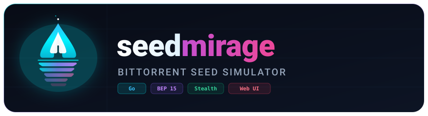
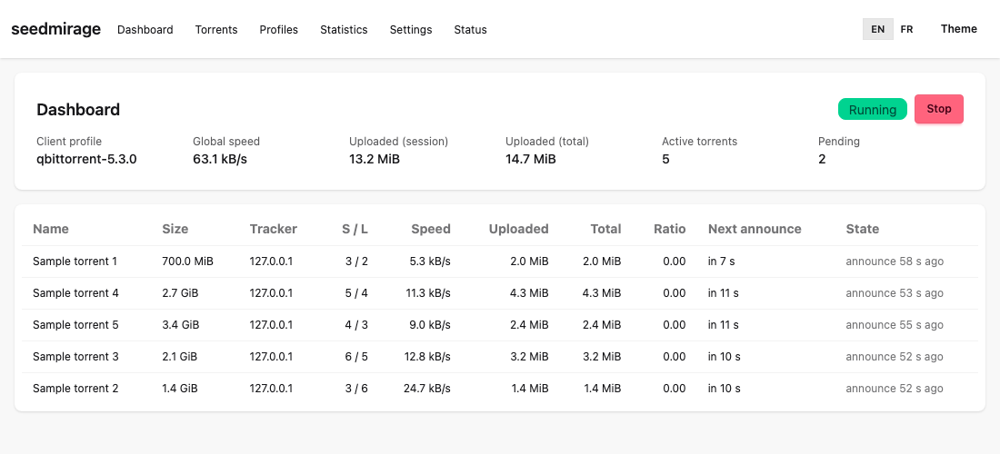
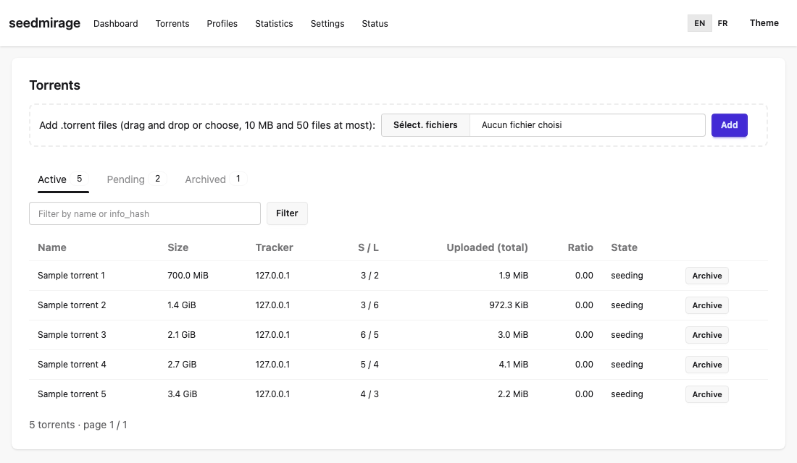
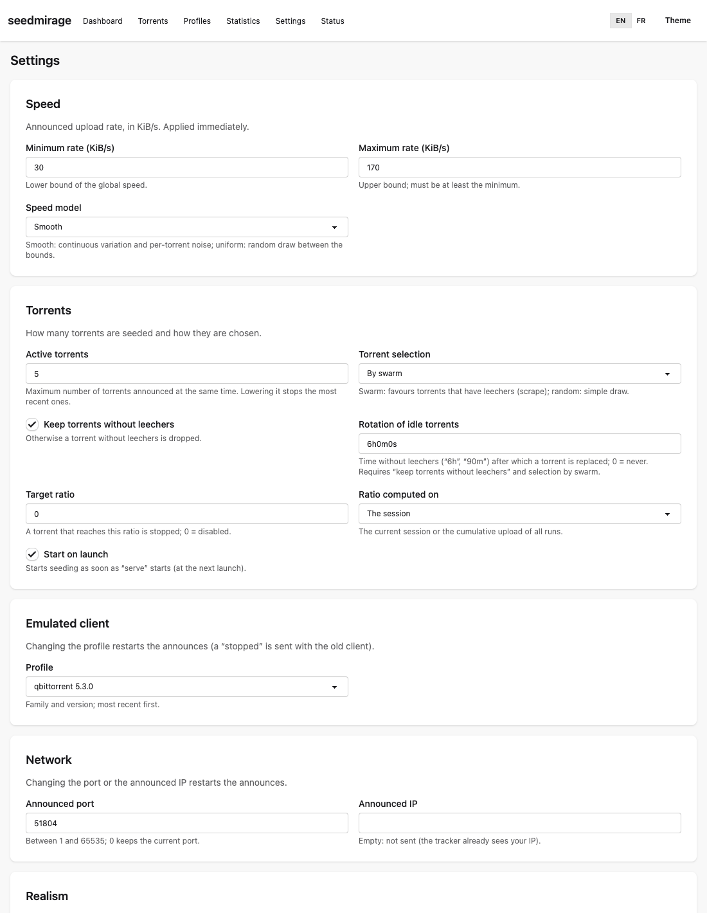
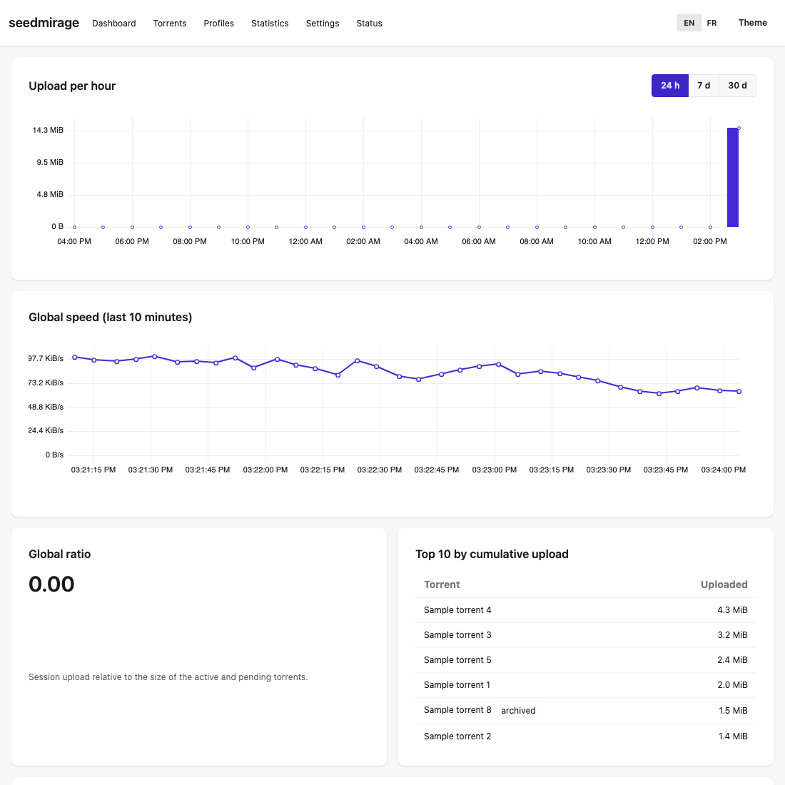
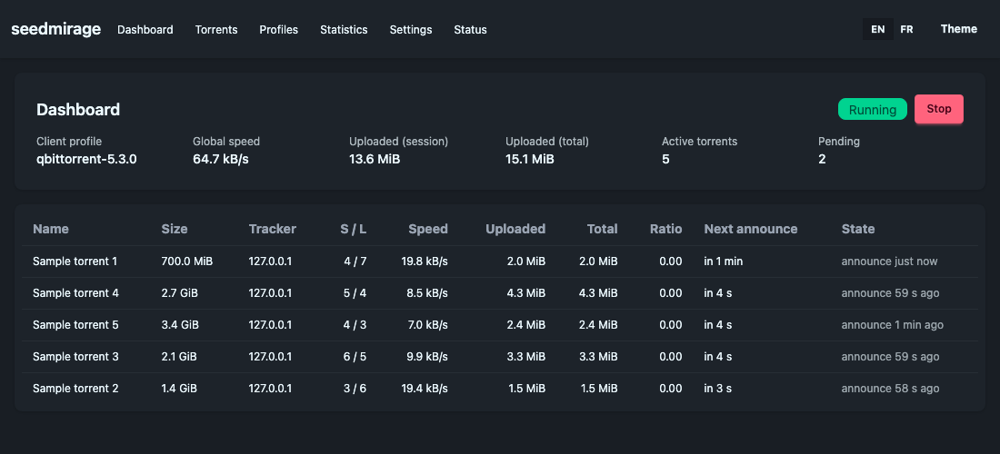

<p align="center">
  
</p>

# seedmirage

A **local** BitTorrent seed simulator written in Go. It announces a realistic upload to trackers without
transferring any data, posing as a recent BitTorrent client (qBittorrent, Transmission, Deluge, rTorrent).
It ships as a single binary with a local web interface, or as a Docker image.

The idea comes from [JOAL](https://github.com/anthonyraymond/joal). seedmirage is written from scratch: it shares
no code, file or format with it.

> **Warning.** Most private trackers forbid this kind of tool and ban the accounts they detect. seedmirage is meant
> for experimentation and for trackers that tolerate it. How you use it, and what happens to your accounts,
> is entirely your responsibility. Nothing in this project aims at getting around a particular tracker.



## Features

- **Client profiles**: qBittorrent 5.3.0 and 4.6.7, Transmission 4.1.4 and 3.00, Deluge 2.2.0, rTorrent 0.16.28. Each profile
  reproduces the announce request of the real client (parameter order, encoding, headers, peer_id and key rules) and cites
  the client source code it was written from. Profiles are checked against captures of the real clients.
  See [`docs/profiles.md`](docs/profiles.md).
- **Capture mode**: `seedmirage capture` records what a real client sends and builds the profile of a new version from it.
  See [`docs/capture.md`](docs/capture.md).
- **Trackers**: HTTP(S) and UDP (BEP 15), tiers (BEP 12), `interval` / `min interval` respected, retry with backoff,
  a clean `stopped` announce for every torrent on exit.
- **Plausible numbers**: upload speed that varies continuously, caps per leecher and per swarm, a maximum daily ratio,
  an optional simulated download, and torrents chosen from the swarm size (scrape).
- **Schedule**: a speed multiplier per hour of the day and weekly pauses.
- **Web interface**: dashboard updated live, torrent list with upload, client profiles, settings applied without a restart,
  statistics. English and French, light and dark themes, readable on a phone-sized window.
- **Local and simple**: no database, no account. One data folder (`config.json`, `clients/`, `torrents/`, `state.json`).
  The interface listens on `127.0.0.1` only by default and is protected by an access token.

## Screenshots

| Torrents | Settings |
|---|---|
|  |  |

| Statistics | Dark theme |
|---|---|
|  |  |

## Quick start

With the binary (Go 1.26 or later to build it; see [`docs/install.md`](docs/install.md) for other options):

```bash
git clone https://github.com/Houtmann/seedmirage.git
cd seedmirage
make build
./bin/seedmirage serve          # opens the interface in your browser
```

With Docker:

```bash
git clone https://github.com/Houtmann/seedmirage.git
cd seedmirage
mkdir -p data
docker compose up -d --build
docker compose logs seedmirage | grep token     # access link, http://127.0.0.1:7070/?token=...
```

Then add your `.torrent` files in the **Torrents** page (or drop them in the `torrents/` folder of the data
directory). seedmirage starts seeding right away. Details in [`docs/usage.md`](docs/usage.md).

Want to try it without a real tracker? Run the demo tracker in a first terminal (it serves a local fake tracker and writes a
few fictitious `.torrent` files), and seedmirage with the same data folder in a second one:

```bash
go run ./scripts/demo-tracker --dir ./data/torrents
./bin/seedmirage serve --data-dir ./data        # or: make run
```

## Documentation

| Page | Content |
|---|---|
| [`docs/install.md`](docs/install.md) | Installation (macOS, Linux, Windows, Docker), data location, upgrade, uninstall |
| [`docs/usage.md`](docs/usage.md) | First launch, torrents, profiles, every setting, statistics, clean shutdown, tracker errors, FAQ |
| [`docs/docker.md`](docs/docker.md) | Docker details: variables, healthcheck, reaching a tracker on the host |
| [`docs/profiles.md`](docs/profiles.md) | Client profile format, embedded profiles, adding a version |
| [`docs/capture.md`](docs/capture.md) | Building a profile from a real client |

## Development

```bash
make check    # gofmt, go vet, golangci-lint, tests with -race, generated CSS, build
make run      # serve with ./data
```

The front end uses vendored htmx, its SSE extension and uPlot, plus a CSS file generated by `make css`
(Tailwind and daisyUI, see `make tools`). Third-party components: [`THIRD_PARTY.md`](THIRD_PARTY.md).

## License

MIT: see [`LICENSE`](LICENSE).
